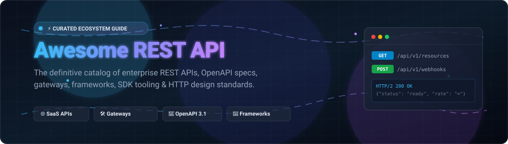

  

# 🚀 Awesome REST API

  
  
  
  
  
  

---

## 🌐 The Definitive REST API Ecosystem Directory

**Curated Catalog of Industry-Standard SaaS APIs, OpenAPI Specifications & Open-Source Frameworks**  
*Focused on Production HTTP API Architecture, Contract-First OpenAPI Tooling & High-Performance Gateways*  

📅 **Last updated:** October 2026

Welcome to the ultimate resource for **RESTful HTTP API design**, enterprise SaaS developer platforms, and high-performance open-source API ecosystems. Whether you are architecting a resilient microservices backend with **FastAPI**, **Express**, or **Spring Boot**, designing API contracts with **OpenAPI Specification** and **JSON Schema**, generating client SDKs via **OpenAPI Generator**, testing with **Bruno** and **Hoppscotch**, or routing production traffic through **Kong** or **Traefik**, this guide provides a structured, comparative overview of the entire landscape.

---

## 📑 Table of Contents

- [📊 Sector Overview & Market Dynamics](#-sector-overview--market-dynamics)
- [☁️ SaaS & Hosted API Platforms](#️-saas--hosted-api-platforms)
- [🛠️ Open-Source GitHub Projects](#️-open-source-github-projects)
  - [📋 Specifications & Standards](#-specifications--standards)
  - [🖥️ Server Frameworks](#️-server-frameworks)
  - [📖 Documentation & SDK Generation](#-documentation--sdk-generation)
  - [🧪 API Clients & Contract Testing](#-api-clients--contract-testing)
  - [🛡️ Gateways & Ingress Controllers](#️-gateways--ingress-controllers)
- [🤝 How to Contribute](#-how-to-contribute)
- [💖 Support & Sponsorship](#-support--sponsorship)
- [📈 Star History](#-star-history)
- [⚠️ Disclaimer](#️-disclaimer)

---

## 📊 Sector Overview & Market Dynamics

The global API management and web API ecosystem is valued at approximately **$8.6 billion to $13.5 billion in 2026** and is projected to expand beyond **$37+ billion by the early 2030s** at a compound annual growth rate (CAGR) of ~20–25%. 

The sector is **moderately consolidated** across enterprise cloud and infrastructure layers—where hyperscalers and established leaders (Microsoft, Google Cloud, Salesforce, Stripe, Shopify) capture significant platform volumes—yet remains dynamically competitive in niche domains. High developer demand for protocol-agnostic gateways, AI-driven API governance, developer productivity tooling, and contract-first workflows continues to fuel rapid innovation across open-source and venture-backed API-first companies.

---

## ☁️ SaaS & Hosted API Platforms

The table below catalogs premier commercial REST API platforms, ordered in descending order by enterprise market size (market capitalization for public entities, latest valuation for private companies, or parent revenue scale).

| Platform | Market Size / Valuation | Description | Starting Pricing | Free Tier / Trial Limit |
| :--- | :--- | :--- | :--- | :--- |
| **[Shopify REST API](https://shopify.dev/docs/api/admin-rest)** | **$219 Billion** (Market Cap) | E-commerce API — comprehensive endpoints for products, orders, customers, inventory, and fulfillment with cursor-based pagination and leaky-bucket rate limiting. | Basic Plan starts at $29/month (billed annually) or $39/month (billed monthly) | Free forever Partner development stores with full Admin REST API access for app testing; 3-day merchant trial for live stores |
| **[Salesforce REST API](https://developer.salesforce.com/docs/atlas.en-us.api_rest.meta/api_rest/)** | **$188 Billion** (Market Cap) | Enterprise CRM API — SOQL queries, composite requests, bulk operations, and robust OAuth 2.0 authentication. | Enterprise Edition starts at $175/user/month (billed annually) with API access included | Free forever Developer Edition org with 15,000 API calls per rolling 24-hour window (or 30-day standard evaluation trial) |
| **[Stripe API](https://stripe.com/docs/api)** | **$159 Billion** (Valuation, 2026) | The industry gold standard for REST API design — predictable resource-oriented URLs, form-encoded request bodies, JSON responses, idempotency keys, and comprehensive error handling. | Pay-as-you-go at 2.9% + $0.30 per successful card transaction; $0 monthly platform fee | Free forever testing in full-featured Test/Sandbox mode with unlimited simulated API calls; $0 upfront cost |
| **[Slack Web API](https://api.slack.com/web)** | **$27.7 Billion** (Salesforce Acquisition) | Messaging API — channels, interactive messages, users, and automated workflows with Web API, Events API, and Socket Mode. | Pro plan starts at $7.25/user/month (billed annually) or $8.75/user/month (billed monthly) | Free forever plan with standard Tier rate limits (~1 msg/sec per channel, 30,000 event deliveries/hr/workspace) and up to 10 app integrations |
| **[Twilio REST API](https://www.twilio.com/docs/usage/api)** | **$43 Billion** (Market Cap) | Cloud communications API — SMS, voice, video, verification, and email with consistent REST conventions, pagination, and webhooks. | Pay-as-you-go starting at $0.0083 per SMS segment (US domestic) | 30-day free trial with 100 free SMS messages (limited to 5 verified recipient phone numbers) |
| **[Plaid API](https://plaid.com/docs/api/)** | **$8 Billion** (Valuation, 2026) | Financial data API — bank account linking, real-time balance checks, transaction categorization, and identity verification. | Pay-as-you-go starting with product fees (e.g. Auth one-time connection fee, Balance per-request fee) with $0 monthly minimum | Free forever Sandbox environment with unlimited mock testing; Free Production Trial plan with up to 10 live connected Items |
| **[SendGrid API](https://docs.sendgrid.com/api-reference/)** | **$3 Billion** (Twilio Acquisition) | Transactional and marketing email API — dynamic templating, delivery analytics, dedicated IP pools, and inbound parse webhooks. | Essentials 50K plan starts at $19.95/month for up to 50,000 emails/month | 60-day free trial with 100 emails per day |
| **[Algolia REST API](https://www.algolia.com/doc/rest-api/)** | **$2.3 Billion** (Valuation) | Search and discovery API — millisecond-latency indexing, neural search, filtering, and recommendations with multi-language SDKs. | Grow plan (Pay-as-you-go) at $0.50 per 1,000 additional search requests after monthly free allowance | Free forever Build plan with 10,000 search requests/month and 50,000 records |
| **[GitHub REST API](https://docs.github.com/en/rest)** | **$2+ Billion ARR** (Microsoft Run Rate) | Developer platform API — repositories, pull requests, actions, webhooks, and issue tracking with extensive machine-readable OpenAPI specs. | Team plan starts at $4/user/month ($48/user/year) | Free forever plan with 5,000 authenticated requests/hour (or 60 unauthenticated requests/hour per IP) |
| **[Contentful REST API](https://www.contentful.com/developers/docs/references/content-delivery-api/)** | **$1.5 Billion** (Salesforce Acquisition) | Composable content management API — global CDN content delivery, management, and preview APIs for headless CMS architectures. | Lite plan starts at $300/month for up to 1,000,000 API calls/month and 100 GB CDN bandwidth | Free forever plan with 100,000 API calls/month, 50 GB CDN bandwidth, and 10,000 content records |

---

## 🛠️ Open-Source GitHub Projects

The open-source ecosystem is organized by category, with every project featuring a live Stars_Badge linking directly to its GitHub stargazers and sorted in **descending order by stars** within each section.

### 📋 Specifications & Standards

The core foundational specifications defining modern machine-readable HTTP APIs.

- **[OpenAPI Specification](https://github.com/OAI/OpenAPI-Specification)**  — The world's most widely used API description format. Provides a language-agnostic interface to HTTP APIs allowing humans and computers to discover and understand service capabilities without access to source code.
- **[API Blueprint](https://github.com/apiaryio/api-blueprint)**  — Powerful high-level, human-readable markdown-based API documentation and design language.
- **[JSON Schema Spec](https://github.com/json-schema-org/json-schema-spec)**  — The international standard vocabulary for annotating and validating JSON data structures and request/response payloads in REST APIs.
- **[RAML Spec](https://github.com/raml-org/raml-spec)**  — RESTful API Modeling Language; a concise YAML-based language for describing and modeling RESTful APIs from design to deployment.

### 🖥️ Server Frameworks

High-performance web frameworks and toolkits optimized for building scalable RESTful web APIs, ranked by stars.

- **[FastAPI](https://github.com/fastapi/fastapi)**  — Modern, ultra-fast Python web framework with automatic interactive OpenAPI docs, Pydantic type validation, asynchronous concurrency, and dependency injection.
- **[Gin](https://github.com/gin-gonic/gin)**  — Blazing fast HTTP web framework written in Go, featuring a martini-like API with custom Radix tree routing, middleware chaining, and JSON validation.
- **[Spring Boot](https://github.com/spring-projects/spring-boot)**  — Enterprise Java framework for building robust production REST services, leveraging Spring MVC, Spring Data REST, and Spring HATEOAS.
- **[NestJS](https://github.com/nestjs/nest)**  — Progressive TypeScript/Node.js framework built with architectural patterns inspired by Angular (decorators, dependency injection, modular controllers).
- **[Express](https://github.com/expressjs/express)**  — Fast, unopinionated, minimalist web framework for Node.js; the historical de facto standard for Node REST APIs.
- **[Rails API](https://github.com/rails/rails)**  — Ruby on Rails API mode, providing lean middleware, ActiveModel serializers, caching, and conventions for rapid REST development.
- **[Fiber](https://github.com/gofiber/fiber)**  — Express-inspired Go web framework built on top of Fasthttp, engineered for zero memory allocation and extreme throughput.
- **[Fastify](https://github.com/fastify/fastify)**  — Highly performant Node.js framework with low overhead, schema-based JSON serialization, and full TypeScript support.
- **[Koa](https://github.com/koajs/koa)**  — Next-generation Node.js middleware framework created by the team behind Express, utilizing async/await primitives without callback hell.
- **[Laravel](https://github.com/laravel/framework)**  — Elegant PHP web framework equipped with first-class REST tooling including Laravel Sanctum, Passport OAuth2, and API resource transformers.
- **[Django REST Framework](https://github.com/encode/django-rest-framework)**  — Flexible toolkit for building Web APIs in Python and Django, featuring automatic browsable web APIs, serializers, viewsets, and granular permissions.
- **[Axum](https://github.com/tokio-rs/axum)**  — Ergonomic and modular web framework built with Tokio, Tower, and Hyper for safe, high-speed REST APIs in Rust.
- **[Actix Web](https://github.com/actix/actix-web)**  — Pragmatic and extremely fast Rust web framework with type-safe extractors, WebSockets, and stateful/stateless handlers.
- **[API Platform](https://github.com/api-platform/api-platform)**  — Advanced PHP framework built on Symfony for creating hypermedia-driven REST and GraphQL APIs with automatic OpenAPI specs and React/Next.js client generation.

### 📖 Documentation & SDK Generation

Tools for designing, publishing interactive references, and compiling multi-language client libraries.

- **[Swagger UI](https://github.com/swagger-api/swagger-ui)**  — The quintessential interactive visual documentation UI rendering OpenAPI/Swagger definitions directly in browser.
- **[OpenAPI Generator](https://github.com/OpenAPITools/openapi-generator)**  — Industrial-grade code generation engine creating client SDKs, server stubs, and documentation across 50+ programming languages from OpenAPI 2.0/3.x specs.
- **[Redoc](https://github.com/Redocly/redoc)**  — Clean, responsive three-panel API documentation generator with effortless search, markdown customization, and code samples.
- **[Swagger Codegen](https://github.com/swagger-api/swagger-codegen)**  — The original OpenAPI client and server generator engine maintained by SmartBear.
- **[Scalar](https://github.com/scalar/scalar)**  — Modern, interactive open-source API reference and client that beautifully renders OpenAPI specifications with integrated testing.
- **[Swagger Editor](https://github.com/swagger-api/swagger-editor)**  — Browser-based YAML and JSON editor for authoring and validating OpenAPI specs with real-time linting.
- **[Stoplight Studio](https://github.com/stoplightio/studio)**  — Visual OpenAPI and JSON Schema modeling application for designing API contracts offline.

### 🧪 API Clients & Contract Testing

Tools for manual testing, contract validation, automated regression suites, and CI/CD pipelines.

- **[Hoppscotch](https://github.com/hoppscotch/hoppscotch)**  — Lightweight, fast, web-based API development ecosystem with real-time WebSocket, SSE, and GraphQL support.
- **[Bruno](https://github.com/usebruno/bruno)**  — Fast, privacy-first, offline API client that saves collections as plain text files directly inside your Git repository.
- **[Insomnia](https://github.com/Kong/insomnia)**  — Robust cross-platform desktop API client for REST, GraphQL, gRPC, and OpenAPI design, maintained by Kong.
- **[Newman](https://github.com/postmanlabs/newman)**  — Official command-line collection runner for Postman, allowing direct execution of Postman test suites in CI/CD pipelines.
- **[Dredd](https://github.com/apiaryio/dredd)**  — Language-agnostic CLI tool for contract testing HTTP APIs against OpenAPI or API Blueprint documentation.
- **[Schemathesis](https://github.com/schemathesis/schemathesis)**  — Modern specification-based property testing tool that automatically generates test cases from OpenAPI definitions to detect edge-case crashes.

### 🛡️ Gateways & Ingress Controllers

Production-grade reverse proxies, authentication layers, and rate-limiting gateways.

- **[Traefik](https://github.com/traefik/traefik)**  — Modern HTTP reverse proxy and ingress controller with automatic service discovery (Docker, Kubernetes) and Let's Encrypt TLS automation.
- **[Kong Gateway](https://github.com/Kong/kong)**  — The most widely adopted cloud-native API gateway, powered by NGINX and OpenResty, featuring a massive plugin ecosystem for auth, security, and observability.
- **[Apache APISIX](https://github.com/apache/apisix)**  — Dynamic, real-time, high-performance API gateway providing traffic management, security filtering, and canary releases.
- **[Tyk Gateway](https://github.com/TykTechnologies/tyk)**  — Batteries-included open-source API gateway written in Go with built-in analytics, rate limiting, quota management, and developer portals.
- **[Envoy Gateway](https://github.com/envoyproxy/gateway)**  — Official Gateway API management project for Kubernetes built on top of the battle-tested Envoy Proxy.
- **[KrakenD](https://github.com/krakend/krakend-ce)**  — Ultra-high performance stateless API gateway built in Go, specializing in API aggregation, response transformation, and circuit breaking.

---

## 🤝 How to Contribute

Contributions are warmly encouraged! To propose updates or add new tools:

1. 🍴 Fork the repository.
2. 🌿 Create a descriptive feature branch (`git checkout -b feature/add-new-api-tool`).
3. 📝 Update `README.md` keeping formatting, links, and factual accuracy intact.
4. 🚀 Submit a Pull Request describing your additions.

---

## 💖 Support & Sponsorship

Thank you for visiting and using **Awesome-Rest-API**! If this curated collection helps your engineering workflow or API architecture:

- ⭐ **Star this repository** to support discoverability!
- 🍴 **Fork and share** it with your developer community and colleagues.
- ☕ **Buy a coffee or sponsor development:** Visit the [GitHub Sponsors Dashboard](https://github.com/sponsors/ishandutta2007) to help support ongoing maintenance and new features.

---

## 📈 Star History

---

## ⚠️ Disclaimer

- This is a **community-curated directory** provided for educational and architectural reference—not a commercial endorsement.
- All trademarks, service marks, and company names are the property of their respective owners.
- When architecting production REST APIs, ensure rigorous compliance with industry standards, transport layer encryption (TLS 1.3), OAuth 2.0 / OIDC security practices, and rate limiting safeguards.
